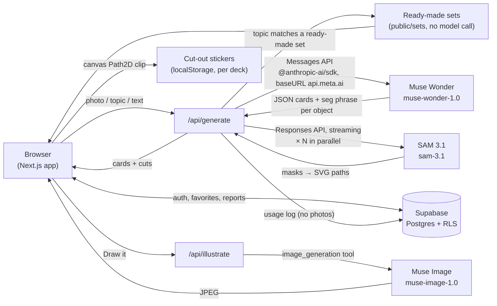

# Cardo: Kurdish Cards

**Everything has a Kurdish name.** Cardo turns a photo, a topic or a pasted text into Kurdish flashcards in seconds, using three Meta models: **Muse Wonder** writes the cards, **SAM 3.1** cuts each object out of the learner's own photo, and **Muse Image** draws a picture for words that have no object. A free tool by [Kurdolingo](https://kurdolingo.com).

- **Live:** https://cardokurdish.vercel.app (mirror: https://kurdicards.vercel.app)
- **Hackathon:** Meta Global AI Developer Hackathon, Indie Developer track, theme "Build for Your World"
- **Built:** November 3–4, 2026 (see [Built during the hackathon](#built-during-the-hackathon-nov-34-2026))

## Why

Kurdish is spoken by tens of millions of people, yet it has very few learning tools, and most apps do not offer it at all. Many Kurdish families in the diaspora have children who understand some Kurdish but cannot name the things around them. Cardo starts from the learner's own world: point the camera at your kitchen table and get cards for the cup, the bread and the spoon, with the object cut out of your own photo.

Cards are in Northern Kurdish, written in the Hawar Latin script, with explanations in the learner's language.

## Features

- **Photo → cards:** take or upload a picture (or press **Try a sample photo**). Muse Wonder recognises objects and writes a card for each: Kurdish word, part of speech, meaning, example sentence and translation, a short note.
- **Cut-out cards (SAM 3.1):** every card for a physical object shows that object cut out of the learner's photo, sticker style with a white edge.
- **Draw it (Muse Image):** any card can get a risograph-style illustration in the Cardo palette, one by one or with **Draw all pictures**.
- **Topic and text → cards:** type a topic (e.g. "kitchen", "weather") or paste a song, story or article.
- **300 ready-made words:** 10 topics × 3 levels, each word with its own illustration. A topic that matches a ready-made set is answered instantly from the set, with no model call.
- **Study, test, keep:** flip cards, a list view, a quiz (meaning, picture, spelling with ç ê î ş û keys), favorites, deck history, a word of the day with a shareable story image (1080×1920).
- **Export:** single cards or whole decks as JPG, PDF or CSV (Anki-ready).
- **Kurdish alphabet page**, **report-a-mistake** button with an admin review list, admin usage dashboard.
- **14 interface languages** (Kurdî, Türkçe, English, Deutsch, Français, Español, Italiano, Português, Русский, العربية, فارسی, 中文, 日本語, 한국어) with right-to-left support for Arabic and Persian.
- Light and dark themes, works on phones.

## Meta models used

| Model | Where | What it does |
| --- | --- | --- |
| `muse-wonder-1.0` | `app/api/generate/route.ts` | Reads the photo (vision) or the topic/text and returns strict JSON cards. In photo mode it also returns an English noun phrase (`seg`) per card that names the object to cut out. |
| `sam-3.1` | `lib/sam.ts` | Segments each named object in the learner's photo. Masks become SVG paths that the browser uses to cut the object out. |
| `muse-image-1.0` | `app/api/illustrate/route.ts`, `components/IllustrateButton.tsx` | Draws a card illustration on demand, in the Cardo risograph style and colour palette. |

**Muse Wonder** is called through the Meta Model API, which speaks the Messages API format, so we use `@anthropic-ai/sdk` with `baseURL: "https://api.meta.ai"` and the Meta key as `authToken`. Photos are resized in the browser and sent as base64 image blocks. We set `output_config: { effort: "low" }` and `max_tokens: 16000` (thinking uses tokens), validate the JSON and retry once if it is malformed.

**SAM 3.1** is called over the Responses API with streaming (`stream: true`, one-bit mask encoding). The stream is parsed with `@meta-sam/parser`; each mask is turned into an SVG path with its bounding box. All SAM calls for a deck run in parallel right after Muse Wonder answers, each with one retry. In the browser (`lib/art.ts`) the object is clipped out of the original photo with `Path2D`, placed on a white sticker edge, and stored in `localStorage` keyed by deck (decks live in the URL hash, so no photo is ever stored on our server).

**Muse Image** is called over the Responses API with the `image_generation` tool, low reasoning strength, and web search, image search and shell turned off. The prompt describes the word's meaning and example sentence and asks for a flat riso print using only the Cardo inks (blue #6a9cc8, pink #e58bcb, olive #8c8519, orange #f04e1f, near-black) on warm paper, with no text. The sample photo behind **Try a sample photo** was also generated with Muse Image.

## Architecture



## Measured numbers

Measured on the live deployment during development:

| Step | Time |
| --- | --- |
| Muse Wonder deck, default effort | ~42 s |
| Muse Wonder deck, `effort: "low"` | ~10 s |
| SAM 3.1, 8 cards in parallel | ~2.7 s |
| Full photo deck (Wonder + SAM cut-outs) | ~12–15 s |
| Muse Image, one illustration | ~10–13 s |
| Topic that matches a ready-made set | instant (no model call) |

Limits: `/api/generate` allows 8 requests per minute per IP, `/api/illustrate` 12 per minute per IP. Errors map to friendly, translated messages (rate, photo, text, topic, busy, photoRead, server).

## Built during the hackathon (Nov 3–4, 2026)

Everything in this repository was built during the hackathon, on November 3 and 4, 2026:

- **Nov 3:** the whole app: Muse Wonder card generation (photo, topic, text), the Cardo design system and UI, study / list / quiz modes, 300-word ready-made sets with illustrations, JPG / PDF / CSV export, word of the day with story image, Kurdish alphabet page, 14 interface languages with RTL, Supabase auth, favorites, reports, admin dashboard, privacy and terms pages, deployment on Vercel.
- **Nov 4:** speed work (`effort: "low"`, ~42 s → ~10 s), SAM 3.1 cut-out cards from the learner's own photo, Muse Image "Draw it" / "Draw all pictures", the "Try a sample photo" button, this README.

## Run locally

Requires Node.js 20+ and a Meta Model API key (dev.meta.ai → API keys).

```bash
npm install
cp .env.example .env.local   # fill in the variables below
npm run dev                  # http://localhost:3005
```

| Variable | What |
| --- | --- |
| `MODEL_API_KEY` | Meta Model API key (used for Muse Wonder, SAM 3.1 and Muse Image) |
| `MODEL_API_BASE_URL` | optional, defaults to `https://api.meta.ai` |
| `MODEL_NAME` | optional, defaults to `muse-wonder-1.0` |
| `MODEL_EFFORT` | optional, defaults to `low` |
| `NEXT_PUBLIC_SUPABASE_URL` | Supabase project URL |
| `NEXT_PUBLIC_SUPABASE_ANON_KEY` | Supabase publishable (anon) key |

Database: run `supabase/schema.sql` once in the Supabase SQL editor (safe to re-run). It creates the tables (profiles, favorites, generations, admins, reports), row-level security policies and the stats functions.

## Tech stack

Next.js 16 (App Router, Turbopack) · React 19 · TypeScript · `@anthropic-ai/sdk` (for the Meta Model API) · `@meta-sam/parser` · Supabase (auth, Postgres, row-level security) · jsPDF · Vercel · Geist / Geist Mono · plain CSS with design tokens (Cardo design system).

## Project map

- `app/` pages: home, `deck`, `sets`, `alphabet`, `login`, `reset-password`, `profile`, `admin`, `privacy`
- `app/api/generate/route.ts` Muse Wonder + SAM 3.1; `app/api/illustrate/route.ts` Muse Image
- `components/` UI (Creator, DeckStudy, Quiz, IllustrateButton, WordOfDay, logo, illustrations)
- `lib/sam.ts` SAM 3.1 client; `lib/art.ts` browser cut-outs and picture storage; `lib/export.ts` JPG / PDF / CSV / story image; `lib/i18n.tsx` + `lib/locales/*` interface languages; `lib/sets.ts` ready-made sets
- `public/sets/` 300-word data (`<topic>.json`) and illustrations (`art/<topic>/<level>-<n>.svg`); `public/sample/` sample photo
- `KURMANCI-KONTROL.md` words flagged for native-speaker review

AI-generated cards can contain mistakes; ready-made content is being reviewed by native speakers. Every card has a report button.

## License and credits

© 2026 [Kurdolingo](https://kurdolingo.com) (info@kurdolingo.com). Code, illustrations and word lists are original work by Kurdolingo, published for the Meta Global AI Developer Hackathon. No open-source license has been chosen yet; please ask before reusing.

Built with Meta's Muse Wonder, SAM 3.1 and Muse Image via the Meta Model API.
